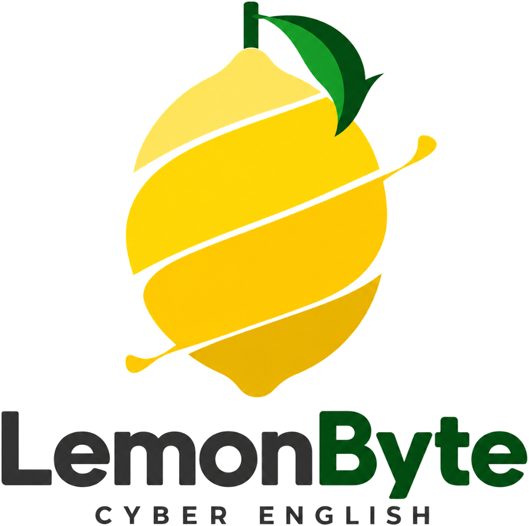
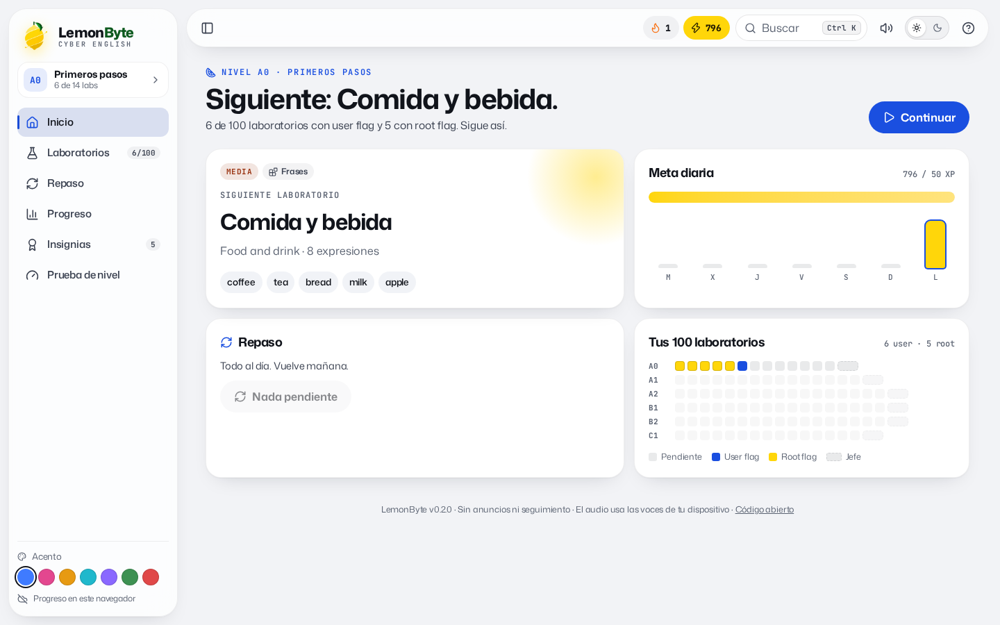
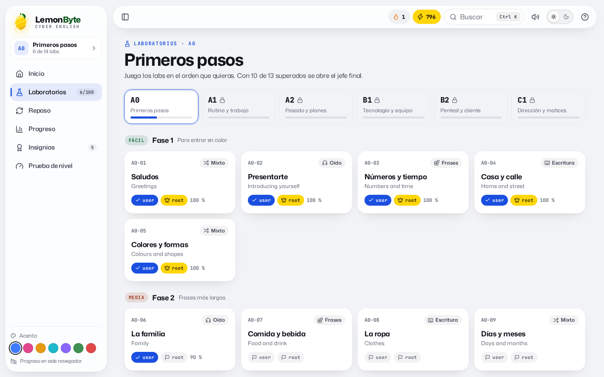
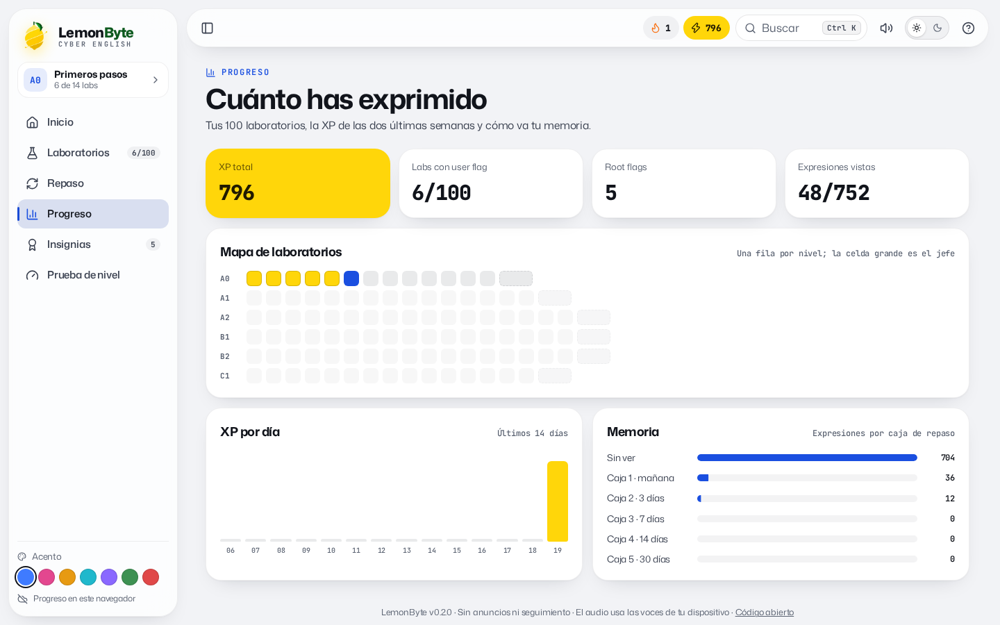
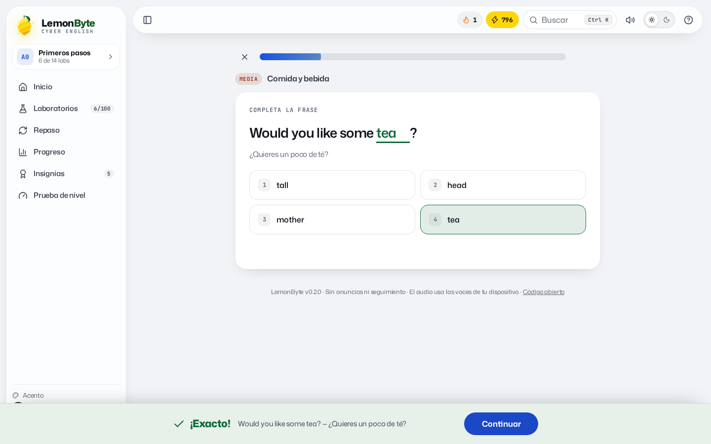
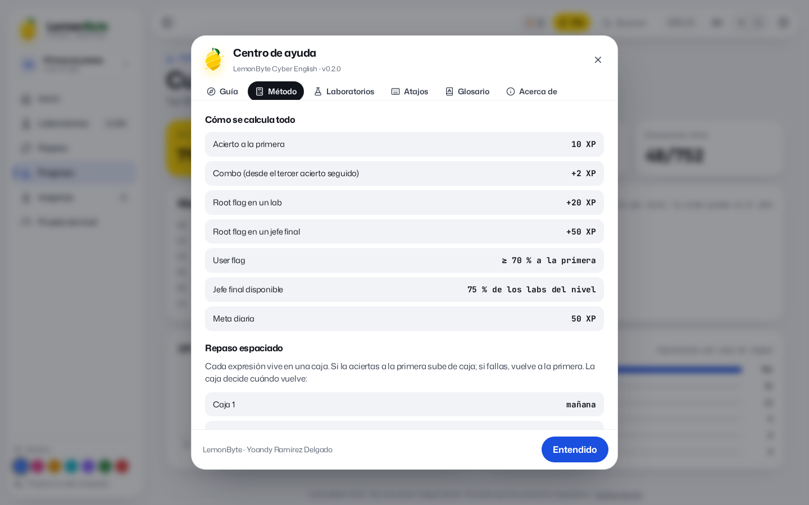

<p align="center">
  
</p>

<p align="center">
  <b>Inglés para IT y ciberseguridad, del primer «hello» al informe de pentest.<br>100 laboratorios con user flag y root flag, jefes finales, XP, rachas, insignias y repaso espaciado.<br>Un solo fichero HTML, sin servidor y sin seguimiento.</b>
</p>

<p align="center">
  <a href="https://heindall92.github.io/lemonbyte/dist/index.html"></a>
</p>

<p align="center">
  <a href="https://github.com/heindall92/lemonbyte/actions/workflows/tests.yml"></a>
  <a href="LICENSE"></a>
  
  
  
  
  
  
</p>

<p align="center">
  <picture>
    <source media="(prefers-color-scheme: dark)" srcset="docs/img/inicio-dark.png">
    
  </picture>
</p>

## Por qué

Las apps de idiomas enseñan a pedir un café. LemonByte empieza por ahí, pero termina explicando un hallazgo al comité de dirección, negociando un plazo con el cliente, redactando una política o comunicando una crisis en inglés. Está pensado para quien trabaja o quiere trabajar en IT, ciberseguridad y GRC, con la mecánica que engancha de las plataformas de pentesting: laboratorios, flags, jefes finales y progreso visible.

## Qué tiene

| | |
|---|---|
| **6 niveles del MCER, 100 laboratorios** | A0 Primeros pasos (14) · A1 Rutina y trabajo (16) · A2 Pasado y planes (18) · B1 Tecnología y equipo (18) · B2 Pentest y cliente (18) · C1 Dirección y matices (16). |
| **752 expresiones** | Cada una con su traducción y una frase de ejemplo. Desde *nice to meet you* hasta *lateral movement*, *rules of engagement*, *risk appetite* o *out of an abundance of caution*. |
| **Fases por dificultad** | En cada nivel: Fácil, Media y Difícil, y al final un **jefe Insane** con doce retos de todo el nivel. Vencerlo abre el nivel siguiente. |
| **Cuatro tipos de laboratorio** | Mixto, Oído (sobre todo escuchar), Frases (ordenar) y Escritura (escribir). Seis tipos de ejercicio en total; lo fallado se repite al final. |
| **User flag y root flag** | La user flag llega con un 70 % de acierto a la primera; la root flag, sin ningún fallo (+20 XP, o +50 en un jefe). |
| **Juego** | XP, combos, racha de días, meta diaria y 29 insignias, cuatro de ellas secretas. |
| **Repaso espaciado** | Cinco cajas al estilo Leitner: cada expresión vuelve a 1, 3, 7, 14 y 30 días. |
| **Sonido** | Efectos de acierto, fallo, flag y root, sintetizados al momento con Web Audio (sin ficheros). Se apagan con un botón. |
| **Voz** | Cada palabra y frase se escucha, también despacio, con las voces en inglés del dispositivo. |
| **Búsqueda Ctrl K** | Encuentra labs y expresiones en inglés o en español, sin importar las tildes. |
| **Centro de ayuda** | Guía, método (generado desde las constantes del código), laboratorios, atajos, glosario y acerca de con el ecosistema. |

<p align="center">
  <picture>
    <source media="(prefers-color-scheme: dark)" srcset="docs/img/labs-dark.png">
    
  </picture>
  <picture>
    <source media="(prefers-color-scheme: dark)" srcset="docs/img/progreso-dark.png">
    
  </picture>
</p>
<p align="center">
  <picture>
    <source media="(prefers-color-scheme: dark)" srcset="docs/img/respuesta-dark.png">
    
  </picture>
  <picture>
    <source media="(prefers-color-scheme: dark)" srcset="docs/img/ayuda-dark.png">
    
  </picture>
</p>

## Cómo usarlo

- **En el navegador:** abre [la app](https://heindall92.github.io/lemonbyte/dist/index.html). El progreso se guarda en tu navegador.
- **Sin conexión:** descarga [`dist/index.html`](dist/index.html) y ábrelo con doble clic.
- **En claude.ai:** [`dist/artifact/lemonbyte.html`](dist/artifact/lemonbyte.html) es la misma app preparada como artifact; allí el progreso se guarda además en tu cuenta y te sigue entre dispositivos.

| Atajo | Acción |
|---|---|
| `Ctrl K` / `⌘K` | Buscar labs y expresiones |
| `1`–`4` | Elegir una opción |
| `Enter` | Comprobar o continuar |
| `Esc` | Cerrar diálogos o salir del lab |
| `←` `→` | Pestañas de la ayuda y niveles |
| `[` | Contraer o abrir la barra lateral |
| `?` | Abrir la ayuda |

## Privacidad y seguridad

- **Cero peticiones de red.** Fuentes (Mona Sans y JetBrains Mono, de Fontsource), iconos (Lucide) y logo van dentro del HTML. El audio usa la síntesis de voz y Web Audio del sistema.
- **CSP por hashes** generada en el build: solo se ejecuta el código de `app/build.js`; `connect-src 'none'`.
- **Progreso saneado al cargar:** un almacenamiento manipulado o corrupto se descarta campo a campo sin romper la app ni contaminar prototipos.

Detalle en [SECURITY.md](SECURITY.md).

## Desarrollo

```bash
node app/build.js          # genera dist/index.html y dist/artifact/lemonbyte.html
./run_tests.sh             # build + motor y contenido + e2e en Chromium + axe-core
python3 docs/capturas.py   # regenera las capturas del README
```

| Parte | Fichero |
|---|---|
| Contenido (un fichero por nivel) | `app/src/content/a0.js` … `c1.js` |
| Motor (lógica pura, sin DOM) | `app/src/engine.js` |
| Interfaz | `app/src/ui.js`, `app/src/body.html`, `app/src/styles.css` |
| Pruebas | `tests/engine.test.js` (27), `tests/e2e_app.py` (63 comprobaciones), `tests/a11y_app.py` (más de 80 estados) |

Las pruebas del contenido comprueban que cada frase de ejemplo contiene su expresión, que no hay expresiones repetidas dentro de un nivel (ni en inglés ni en español) y que cada uno de los ejercicios posibles de las 752 expresiones tiene una sola respuesta correcta.

## Ecosistema

LemonByte es la herramienta de formación del ecosistema de [Yoandy Ramírez Delgado](https://github.com/heindall92): [Rosetta Multinorma](https://github.com/heindall92/rosetta_multinorma), [CTEM-Nexus](https://github.com/heindall92/ctem-nexus), [KAIROS](https://github.com/heindall92/kairos), [ENS Compliance Studio](https://github.com/heindall92/grc_ens_compliance_studio), [ENS AD Auditor](https://github.com/heindall92/ens_ad-auditor), [ARGOS](https://github.com/heindall92/argos-grc), [MCP-Shield](https://github.com/heindall92/mcp-shield) y [Norvik](https://github.com/heindall92/Norvik_Gobernanza).

## Licencia

GPLv2. Fuentes Mona Sans y JetBrains Mono bajo SIL Open Font License 1.1 (`app/vendor/`). Iconos Lucide bajo ISC. Proyecto independiente: no está afiliado al Consejo de Europa (MCER), Cambridge English, INE ni Hack The Box.
