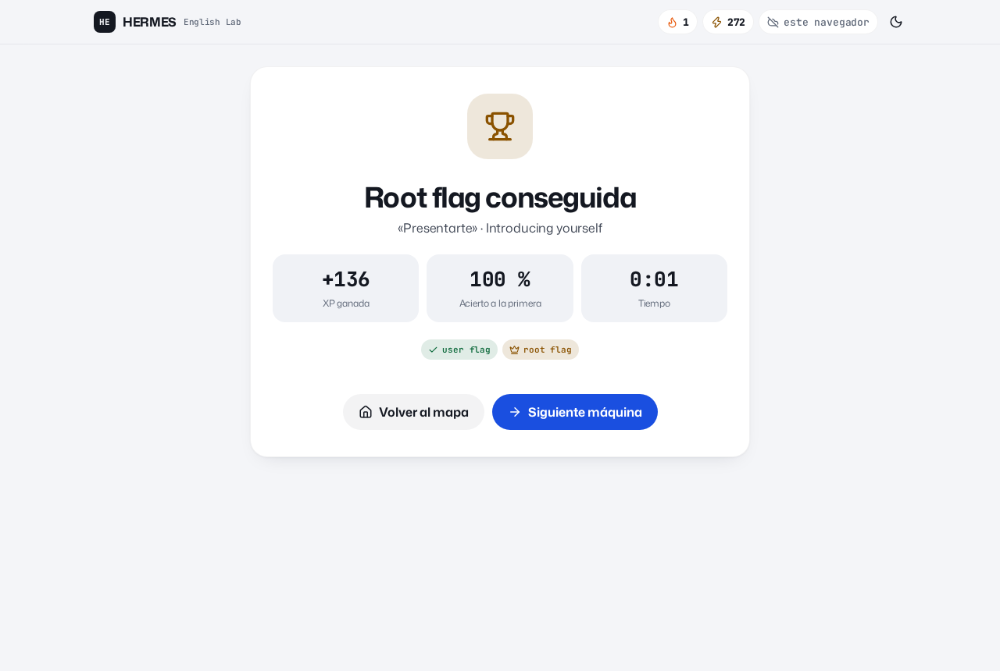

<h1 align="center">HERMES · English Lab</h1>

<p align="center">
  <b>Aprende inglés del A0 al C1 como quien resuelve máquinas: cada unidad tiene su user flag y su root flag.<br>XP, rachas, insignias y repaso espaciado, en un solo fichero HTML que funciona sin servidor.</b>
</p>

<p align="center">
  <a href="https://heindall92.github.io/hermes-english-lab/dist/index.html"></a>
</p>

<p align="center">
  <a href="https://github.com/heindall92/hermes-english-lab/actions/workflows/tests.yml"></a>
  <a href="LICENSE"></a>
  
  
  
  
</p>

<p align="center">
  <picture>
    <source media="(prefers-color-scheme: dark)" srcset="docs/img/inicio-dark.png">
    
  </picture>
</p>

## Por qué

Las apps de idiomas enseñan a pedir un café. HERMES empieza por ahí, pero termina explicando un hallazgo al comité de dirección, negociando un plazo con el cliente y defendiendo un presupuesto en inglés. Está pensado para quien trabaja en IT, ciberseguridad y GRC y necesita inglés profesional, con la mecánica que engancha de las plataformas de pentesting: máquinas, flags y progreso visible.

## Qué tiene

| | |
|---|---|
| **6 niveles del MCER** | A0 Primeros pasos · A1 Rutina y trabajo · A2 Pasado y planes · B1 Tecnología y equipo · B2 Pentest y cliente · C1 Dirección y matices |
| **24 máquinas, 192 expresiones** | Cada expresión con su traducción y una frase de ejemplo real. Desde *nice to meet you* hasta *rules of engagement*, *executive summary* o *it boils down to*. |
| **User flag y root flag** | La user flag se consigue con un 70 % de acierto a la primera; la root flag, sin ningún fallo (+20 XP). El siguiente nivel se abre con todas las user flags del anterior. |
| **6 tipos de ejercicio** | Qué significa, cómo se dice, escucha y elige, completa la frase, ordena las palabras y escríbelo. Lo que fallas vuelve al final de la lección. |
| **Juego** | XP, combos desde el tercer acierto seguido, racha de días, meta diaria de 50 XP y 21 insignias (*Oído fino*, *Constructor de frases*, *Pentester bilingüe*, *Root total*…). |
| **Repaso espaciado** | Sistema Leitner de 5 cajas: cada expresión vuelve a 1, 3, 7, 14 y 30 días; si la fallas, mañana. |
| **Prueba de nivel** | Dos preguntas por nivel; abre directamente los niveles que ya dominas. |
| **Audio** | Cada palabra y frase se escucha, también despacio, con las voces en inglés del propio dispositivo. |
| **Teclado** | Teclas 1–4 para responder y Enter para continuar. |

<p align="center">
  <picture>
    <source media="(prefers-color-scheme: dark)" srcset="docs/img/respuesta-dark.png">
    
  </picture>
  <picture>
    <source media="(prefers-color-scheme: dark)" srcset="docs/img/final-dark.png">
    
  </picture>
</p>

## Cómo usarlo

- **En el navegador:** abre [la app](https://heindall92.github.io/hermes-english-lab/dist/index.html). El progreso se guarda en tu navegador.
- **Sin conexión:** descarga [`dist/index.html`](dist/index.html) y ábrelo con doble clic. Funciona igual, sin internet.
- **En claude.ai:** [`dist/artifact/hermes.html`](dist/artifact/hermes.html) es la misma app preparada para publicarse como artifact; allí el progreso se guarda además en tu cuenta y te sigue entre dispositivos.

## Privacidad y seguridad

- **Cero peticiones de red.** Fuentes (Mona Sans y JetBrains Mono, de Fontsource) e iconos (Lucide) van dentro del HTML. El audio usa la síntesis de voz del sistema.
- **CSP por hashes** generada en el build: solo se ejecuta el código que sale de `app/build.js`; `connect-src 'none'`.
- **Progreso saneado al cargar:** un `localStorage` manipulado o corrupto se descarta campo a campo sin romper la app ni contaminar prototipos.

Detalle en [SECURITY.md](SECURITY.md).

## Desarrollo

```bash
node app/build.js          # genera dist/index.html y dist/artifact/hermes.html
./run_tests.sh             # build + motor + e2e en Chromium + axe-core
python3 docs/capturas.py   # regenera las capturas del README
```

| Parte | Fichero |
|---|---|
| Contenido del curso | `app/src/content.js` |
| Motor (lógica pura, sin DOM) | `app/src/engine.js` |
| Interfaz | `app/src/ui.js`, `app/src/body.html`, `app/src/styles.css` |
| Pruebas | `tests/engine.test.js` (21), `tests/e2e_app.py` (40 comprobaciones), `tests/a11y_app.py` (48 estados) |

Para añadir una unidad, sigue el formato de `content.js`. Las pruebas comprueban que cada frase de ejemplo contiene su expresión, que no hay expresiones repetidas en un nivel y que cada ejercicio tiene una sola respuesta correcta.

## Ecosistema

HERMES es la herramienta de formación del ecosistema de [Yoandy Ramírez Delgado](https://github.com/heindall92): [Rosetta Multinorma](https://github.com/heindall92/rosetta_multinorma), [CTEM-Nexus](https://github.com/heindall92/ctem-nexus), [KAIROS](https://github.com/heindall92/kairos), [ENS Compliance Studio](https://github.com/heindall92/grc_ens_compliance_studio), [ENS AD Auditor](https://github.com/heindall92/ens_ad-auditor), [ARGOS](https://github.com/heindall92/argos-grc), [MCP-Shield](https://github.com/heindall92/mcp-shield) y [Norvik](https://github.com/heindall92/Norvik_Gobernanza).

## Licencia

GPLv2. Fuentes Mona Sans y JetBrains Mono bajo SIL Open Font License 1.1 (`app/vendor/`). Iconos Lucide bajo ISC.
